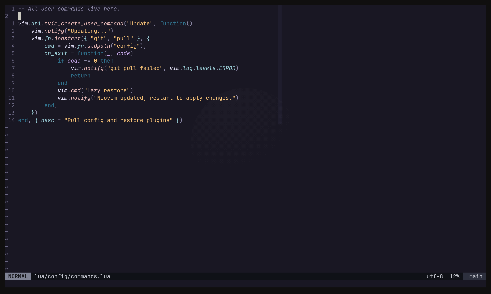

> Minimal Neovim config. ~15ms startup, lazy-loaded, one file per plugin.



### Requirements

- Neovim >= 0.11
- `git`, [ripgrep](https://github.com/BurntSushi/ripgrep), [fzf](https://github.com/junegunn/fzf)
- A [Nerd Font](https://www.nerdfonts.com/)
- Optional: `tmux` (sessionizer), [yazi](https://github.com/sxyazi/yazi), [lazygit](https://github.com/jesseduffield/lazygit)

### Install

```bash
mv ~/.config/nvim ~/.config/nvim.bak  # backup existing config
git clone https://github.com/eoSalinas/nvim ~/.config/nvim
nvim  # plugins and LSP servers install on first launch
```

Update with `:Update` (pulls the repo and restores the plugin versions in `lazy-lock.json`).

### Structure

```
lua/config/   options, keymaps, user commands, plugin manager
lua/plugins/  one file per plugin
```

### Plugins

| | |
|---|---|
| **Find** | [fzf-lua](https://github.com/ibhagwan/fzf-lua), [harpoon](https://github.com/ThePrimeagen/harpoon/tree/harpoon2), [oil.nvim](https://github.com/stevearc/oil.nvim) |
| **LSP** | [nvim-lspconfig](https://github.com/neovim/nvim-lspconfig), [mason.nvim](https://github.com/mason-org/mason.nvim), [blink.cmp](https://github.com/Saghen/blink.cmp), [conform.nvim](https://github.com/stevearc/conform.nvim), [lazydev.nvim](https://github.com/folke/lazydev.nvim) |
| **Git** | [gitsigns.nvim](https://github.com/lewis6991/gitsigns.nvim), [lazygit.nvim](https://github.com/kdheepak/lazygit.nvim) |
| **Editing** | [nvim-treesitter](https://github.com/nvim-treesitter/nvim-treesitter) (+ [context](https://github.com/nvim-treesitter/nvim-treesitter-context)), [mini.pairs](https://github.com/echasnovski/mini.pairs), [grug-far.nvim](https://github.com/MagicDuck/grug-far.nvim), [undotree](https://github.com/mbbill/undotree), [vim-sleuth](https://github.com/tpope/vim-sleuth) |
| **UI** | [rose-pine](https://github.com/rose-pine/neovim), [lualine.nvim](https://github.com/nvim-lualine/lualine.nvim), [render-markdown.nvim](https://github.com/MeanderingProgrammer/render-markdown.nvim), [todo-comments.nvim](https://github.com/folke/todo-comments.nvim), [indent-blankline.nvim](https://github.com/lukas-reineke/indent-blankline.nvim) |

### Keymaps

`<leader>` is `Space`. Essentials below; the full list lives in
[`lua/config/keymaps.lua`](lua/config/keymaps.lua), or search it inside nvim with `<leader>fk`.

| Key | Action |
|---|---|
| `<C-n>` | Find files |
| `<leader>ps` | Live grep |
| `<C-b>` | File explorer (oil) |
| `<leader>a` / `<C-e>` | Harpoon add / menu |
| `gd` / `grr` | Go to definition / references |
| `<leader>ca` | Code actions |
| `<leader>cf` | Format buffer |
| `<leader>gl` | LazyGit |
| `<leader>u` | Undotree |
